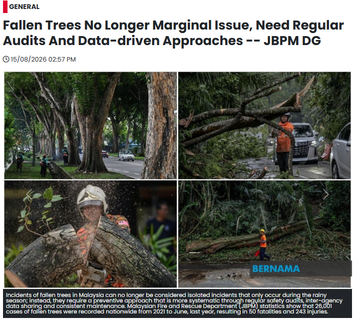

# Problem Statement and Scope
## Problem Statement
Many roadside and park trees must be inspect by local council officers in Malaysia, but tree risk assessment still relies heavily on physical observation of trunks cracks, decay, leaning angle, roots and soil conditions (Bernama, 2026a). This is labour-intensive, so high-risk trees can be missed and endanger road users and residents nearby. The statistics from the Fire and Rescue Department recorded 26,001 fallen-tree cases from 2021 to June 2025, resulting 50 fatalities and 243 injuries (Bernama, 2026b). Recently, there was an incident involving two UiTM lecturer who got injured when crushed by a tree while driving in february 2026 at Section 7, Shah Alam (Bernama, 2026a).

*Figure 1: Fallen Trees No Longer Marginal Issue, Need Regular Audits And Data-driven Approaches -- JBPM DG*

## User and Stakeholders
1. Local council officers and landscape staff - roadside and park tress inspector, use CNN technique risk results to prioritise inspections and decide on pruning or removal.

2. Arborists and tree contractors - Qualified tree experts is still needed to verify the results from CNN, AI can't replace, it just a tool to make their work easier.

3. Public and residents - report suspicious trees with photo, then received a simple risk indication and put location.

4. Research and technical experts - supply reviewed species and defect knowledge, and validate the model's accuracy for tropical trees.

5. Fire and Rescue Department (JBPM): shares fallen-tree incident data.

## Scope

**In scope:** 
1. Using a CNN to classify visible defects and visible warning signs such as trunk cavity, cracks, leaning angle and dead branches.
2. Focuses on Angsana species, also known as Pterocarpus indicus in scientific name, as they are common in urban areas in Malaysia.
3. Giving a risk level such as low, moderate or high with confidence score .
4. Recommending detailed arborist inspection for high risk trees.

**Out of scope:** 
1. Direct measurement of internal decay or root condition because its needs tools such as sonic tomography or ground-penetrating radar
2. GIS mapping dashboards
3. Other tree species 
4. Weather or wind forecasting
5. Drones or LiDAR
6. A public reporting system for residents.

References are listed in [References.md](references.md).